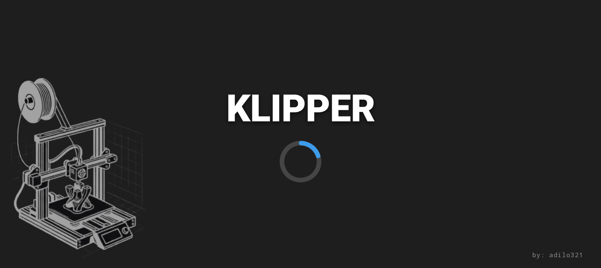
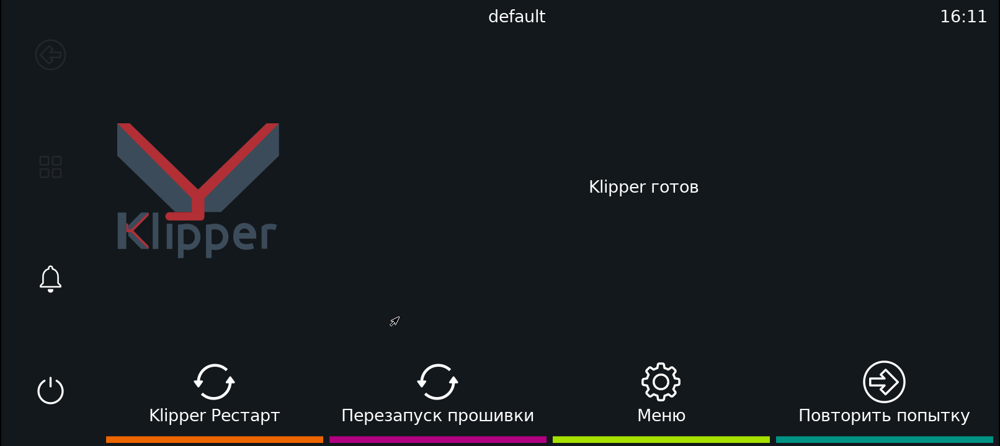

# Klipper на Android без root — TECNO BF6 + Ender 3 V3 SE

Готовый набор скриптов, конфигов и инструкций для превращения старого Android-телефона в автономный хост Klipper для Ender 3 V3 SE. Без root, без proot: всё работает внутри Termux, принтер подключается по USB-C OTG через PTY-мост.

Проверено на **TECNO BF6 (POP 7)**, Android 12 / API 31, HiOS, экран 720×1612 (landscape 1612×720), 2 ГБ ОЗУ. Принтер — **Ender 3 V3 SE**, плата Creality 4.2.2 / GD32F303.

> Klipper управляет нагревателями и моторами. Ошибка в конфиге или прошивке может испортить принтер или создать пожарную опасность. Не оставляйте печать без присмотра, пока не проверены термисторы, thermal runaway и концевые выключатели. Все действия — на ваш риск.

## Скриншоты

| Заставка при загрузке | KlipperScreen (русский UI) |
|---|---|
|  |  |

## Что работает

- Klipper, Moonraker, nginx и USB-мост под runit.
- Mainsail на `:8080`, Fluidd на `:8081`, Moonraker API на `:7125`.
- KlipperScreen на Termux:X11: landscape, полный экран, русский язык, без гашения экрана, Direct touch.
- Автозапуск через собственный HOME-лаунчер `com.klipper.launcher` (обход блокировки Termux:Boot в HiOS).
- Брендированная заставка: принтер, «KLIPPER», синий спиннер, «by: adilo321» — держится, пока не поднимутся Moonraker и оба веб-интерфейса.
- Прошивка MCU собрана из того же коммита Klipper `60fc7aa`, что и хост.

## Структура репозитория

```text
.
├─ AI-INSTALL-GUIDE.md          # полный self-contained гайд для ИИ и людей (главный файл)
├─ README-KIPPER.md             # короткая шпаргалка по уже работающей установке
├─ screenshots/
│  ├─ splash.png                # заставка при загрузке
│  └─ klipperscreen.png         # KlipperScreen, русский UI
├─ config/
│  ├─ printer.cfg               # Ender 3 V3 SE, PTY-мост, BLTouch/CR-Touch, bed mesh 5×5
│  ├─ moonraker.conf            # provider: none, trusted_clients только LAN
│  ├─ nginx.conf                # Mainsail :8080 + Fluidd :8081 + WebSocket proxy
│  ├─ KlipperScreen.conf        # language: ru, screen_blanking: off, сеть скрыта
│  └─ bridge.conf.example       # шаблон без реального токена
├─ scripts/
│  ├─ start-klipper.sh          # boot-скрипт: runit, Termux:X11, watchdog, splash-режим
│  ├─ ks_watchdog.sh            # перезапуск KlipperScreen/X11
│  ├─ start_klipperscreen.sh    # ручной запуск UI
│  ├─ patch_ks.py               # патчи KlipperScreen под Termux (идемпотентно)
│  └─ finalize-termux.sh        # chmod + чистый перезапуск UI
├─ launcher/                    # исходники HOME-лаунчера и заставки
│  ├─ AndroidManifest.xml
│  ├─ build.ps1
│  ├─ src/com/klipper/launcher/MainActivity.java
│  ├─ src/com/klipper/launcher/SplashView.java
│  └─ res/drawable/logo.png
├─ firmware/
│  ├─ config                    # полный .config Klipper для STM32F103xe / 28KiB bootloader
│  ├─ klipper-ender3v3se-60fc7aa.bin
│  ├─ SHA256.txt
│  └─ README.md
└─ removed-packages.txt         # 23 удалённых пакета TECNO (обратимо)
```

## Быстрый старт

1. Прочитайте `AI-INSTALL-GUIDE.md` целиком. Это не набор copy-paste команд: в нём есть проверки после каждого этапа и разбор реальных ошибок.
2. Установите Termux, Termux:X11, Klipper For Android и Klipper Launcher.
3. Выполните базовую установку `thingsapart/klipper_termux`.
4. Скопируйте конфиги из `config/` в `~/printer_data/config/`, замените `<TOKEN>` в `bridge.conf` на реальный токен моста.
5. Скопируйте скрипты из `scripts/` в Termux-home и выставьте `chmod +x`.
6. Соберите и установите лаунчер по `launcher/README.md`.
7. Прошейте MCU файлом из `firmware/` (FAT32 microSD), подключите OTG, откалибруйте `z_offset` и bed mesh.

Подробности, точные команды, логи и диагностика — в `AI-INSTALL-GUIDE.md`.

## Проверенные версии

| Компонент | Версия / коммит |
|---|---|
| Termux | 0.118.3 |
| Termux:X11 | 1.03.01 |
| Klipper (host + MCU) | `60fc7aa` |
| Moonraker | `d5ee171` |
| Mainsail | v2.18.2 |
| Fluidd | v1.37.7 |
| KlipperScreen | `34610ce` |
| Python | 3.14.8 |
| nginx | 1.31.8 |
| Klipper Launcher | 1.0 (`com.klipper.launcher`) |
| Прошивка | 40 160 байт, SHA256 `FD8C61A21F06A87C4BA077FF6DA44FE584F6E19349218B3EE61E7E6A57D25CA3` |

## Важные предупреждения

- **Хост и MCU должны быть из одного коммита Klipper.** Обновили хост — пересоберите и перепрошейте MCU.
- **Не используйте `/system/bin/am`** на Android 12+ из-под UID Termux. Только `$PREFIX/bin/am`.
- **Не ищите `/dev/ttyACM0`.** На Android без root используется PTY `/data/data/com.termux/files/usr/var/run/klipper-android/main`.
- **Не публикуйте** реальный IP, серийник телефона, токен `bridge.conf`, пароль SSH и keystore.
- **Не открывайте** порты `7125`, `8080`, `8081` в интернет. Это локальный сервис.
- Перед перезагрузкой проверьте заряд: при <30–40% телефон может выключиться в середине boot-последовательности.

## Благодарности

- [thingsapart/klipper_termux](https://github.com/thingsapart/klipper_termux) — базовая нативная установка Klipper на Android.
- [Klipper](https://github.com/Klipper3d/klipper), [Moonraker](https://github.com/Arksine/moonraker), [Mainsail](https://github.com/mainsail-crew/mainsail), [Fluidd](https://github.com/fluidd-core/fluidd), [KlipperScreen](https://github.com/KlipperScreen/KlipperScreen).
- [Termux](https://github.com/termux/termux-app), [Termux:X11](https://github.com/termux/termux-x11).

## Лицензия

Оригинальные скрипты, конфиги и документация — MIT, см. `LICENSE`. Прошивка собрана из Klipper (GPLv3); исходники — в upstream-репозитории Klipper на коммите `60fc7aa`. Сторонние проекты сохраняют свои лицензии, см. `NOTICE.md`.
